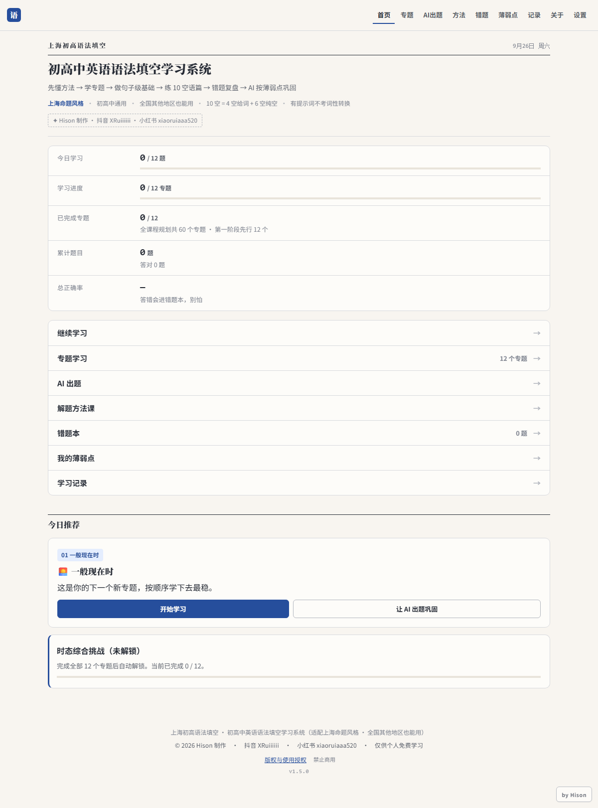

# 上海初高语法填空

一个用浏览器打开就能做语法填空的练习工具。内容按**上海命题风格**整理（10 空 = 约 5 空有提示词 + 5 空无提示词，真卷在 4-6 之间浮动，有提示词不考词性转换），初高中都能用，**全国其他地区也可以照常使用**——时态、非谓语、三大从句、介词、冠词、代词这些考点是通用的。默认从高一基础开始。

> 仓库名 / 产物文件名仍是 `english-grammar-lab`、`English-Grammar-Lab.html`，方便已发布的链接继续可用；页面里显示的产品名是「上海初高语法填空」。



## 怎么用

下载根目录的 `English-Grammar-Lab.html`，双击打开就能做题。CSS、JS、题库全内联在这一个文件里，不用装任何东西，断网也能用（只有 AI 出题需要联网）。

- 做题记录、错题、复习排期和笔记都存在你自己浏览器的 localStorage 里，不会传到任何服务器。换浏览器或清缓存前，去「学习记录 → 数据管理」导出备份（超过 7 天没备份，记录页会提醒你）。
- AI 出题支持 TeamoRouter、DeepSeek、OpenAI、通义千问、硅基流动、Kimi、智谱、OpenRouter，以及任意 OpenAI 兼容接口。默认走 TeamoRouter 的 `deepseek-v4-flash`，并自动启用低推理加速；也可切回 DeepSeek 官方或其他模型商。在「AI 出题」页填 API Key 后，点「获取模型列表」即可选择模型，也可以手动输入模型 ID。Key 默认只留在当前页面，勾了「记住」才按模型商分别存到本机，随时能清除。不填 Key 也不影响做内置题库。应用是纯静态网页，会从浏览器直连模型商，所以模型商需要允许跨域（CORS）；如果某个官方接口不允许，可改用「自定义（OpenAI 兼容）」填自己的网关地址。
- AI 生成的答题形式默认是**填空输入**（和上海真卷一致），点选只作为“不方便打字”时的备选；解析看不懂时可以点「让 AI 用更简单的话讲这道题」，结果按题缓存，不重复消耗额度。
- 它是纯前端工具，没有账号系统，别拿它当多人在线考试用。

第一次打开会弹一次版权说明，点「我已知晓」关掉就行。

## 里面有什么

考点按 11 个大专题组织：谓语动词、非谓语动词、形容词/副词比较等级、定语从句、名词性从句、状语从句、介词、冠词、代词、并列与逻辑、其他拓展。这是上海卷的口径——10 空 = 约 5 空有提示词 + 5 空无提示词（真卷 4-6 浮动）；有提示词只考动词变形与形副比较级/最高级，**不考词性转换**（没有 care→careful→carefully 这类题）。

- **上海真题语篇**：8 篇整篇 10 空练习，取自上海春考/高考与各区一模二模（个别空位为唯一答案做了微调）：被子里的家族史、球场噪声的两面性、极光的观赏、青年创业组织、组乐队指南、在佛罗伦萨的一学期、常书鸿父女与敦煌、巴黎圣母院的修复。按真卷规格整篇作答——先通读、再逐空填、交卷后逐空看解析；解析照区教研室答案详解写：**考查点 → 句意 → 线索 → 判断 → 其它形式为何不行 → 一句话记忆**。做错的空自动进错题本并计入大专题能力。
- **内置题库**：谓语动词·时态 01–12 十二个专题，每个专题 12 道核心题加 6 道扩展题，另有 20 道时态综合挑战（12 个专题做完后解锁）。其他大专题没有内置题目，配合 AI 出题用。
- **解题方法课**：把上海卷做题顺序拆成 5 步——先通读数谓语，给词先分"动词 / 形副"两类，无词按"连词 > 介词 > 冠词 > 代词 > 情态"排查，最后通读复查；另有无提示词 5 类候选池、快速排查流程和上海高频坑。
- **知识卡**：每个专题一张，写清一句话理解、术语、判断流程、最容易错的地方和例句。
- **解析**：每题都有判断链、为什么是这个答案、为什么其他答案不合适、一句话记忆，还有一句「如果你在考试现场」该怎么处理。解析默认折叠，不提前剧透。
- **练习**：句子级有普通模式（做完一题立刻看解析）和盲做模式（一轮做完再对答案）。真题语篇与 AI 生成的语篇都是 10 空一篇、全部空一起作答，做完进同一套判分流程。桌面端支持键盘答题（1–6/A–F 选、Enter 提交或下一题、Esc 退出），输入题自动聚焦。做错的题自动进错题本，按大专题统计，首页能看到自己的薄弱点。
- **今日复习（间隔重复）**：做错的题按 1 / 2 / 4 / 7 / 15 天排期，答对升一档、答错回到第一档，连续答对 5 次记为「已掌握」。首页显示今天到期多少空，一键混排复习跨专题、真题语篇和 AI 题。
- **错题本**：可按大专题 / 来源 / 状态筛选，按最近出错、错误次数或复习到期排序；每题可以「重做这题」、写一句「我为什么错」，也能打印当前筛选结果。
- **我的专卷**：按当前薄弱点自动抽 10 空组一套卷（优先未掌握错题 → 最弱的大专题 → 题库扩展题），可保存重做、限时做、打印。
- **真题考点频次**：8 篇真题语篇按大专题聚合，一眼看出哪类考点出现得最多、哪几类还没抽到。
- **限时模拟考**：整篇卷面可开 10 分钟倒计时，到点自动交卷；未作答的空只计分、不进错题本。
- **打印 / 存 PDF**：练习卷（带答题线）、答案与解析页、错题单、专卷、成绩单都能一键打印，用浏览器「另存为 PDF」即可。
- **AI 出题**：提示词按真卷口径写——10 空、250-330 词、首句不设空、有提示词 4-6 空、无提示词 4-6 空（固定搭配最多 2 空）、上海高频坑清单、解析六要素；默认生成填空输入，也可以选点选。可选「按我的薄弱点命题」，把最近错得多的考点写进必考清单；生成过程可以停止，好题能一键导出成 `bank-papers-*.js` 题库文件。
- **AI 讲解**：解析下方可让 AI 用更简单的话重讲这道题，给出同类例句与易混点；结果按题缓存。
- **设置**：背景四档（纸白 / 米黄 / 灰青 / 墨夜）、字号三档（标准 / 大 / 特大）、每日目标（5 / 10 / 12 / 20 题）、当前模型商 API Key 的保存与清除，以及数据管理入口。设置只存在本机浏览器。

## 自己改

源码在 `src/`，题库在 `data/`，根目录那个 HTML 是构建产物——改完源码一定要重新构建，否则成品和源码会对不上。

```
npm run build       # 重新生成 English-Grammar-Lab.html
npm test            # 题库结构 + 引擎 + 练习流程 + 迁移/复习/组卷/画像 + DOM 渲染 + AI 转换
npm run test:build  # 检查成品文件完整性
```

需要 Node 18 以上，没有第三方依赖，不用 `npm install`。

新增内置专题：照 `spec/DATA_SCHEMA.md` 写一个 `data/bank-*.js`，再到 `data/curriculum.js` 里登记它属于哪个大专题。
新增真题语篇：照 `spec/DATA_SCHEMA.md` 第二部分写 `data/bank-papers-NN.js`（`window.__EGL_PAPERS__`，一篇 10 空 + 六项解析），`validate/check.js` 会自动校验空数、提示词位置、答案是否泄漏和解析是否齐全。AI 出题页的「导出题库」也会产出同格式文件。
界面部分在 `src/ui-*.js`（视图、练习、AI 出题），引擎在 `src/core.js`，打印在 `src/print.js`，AI 相关逻辑（模型商、Base URL、Key、/models 与 /chat/completions、命题提示词、AI 讲解、导出题库）在 `src/ai.js`。
数据结构版本为 v3（`EGL_LAB_DATA_v1`），老版本的本地数据会在读取时自动补齐字段，不会丢记录。

## 版权

个人免费自学使用，禁止任何商业用途——培训机构或补课班授课、付费课程与讲义、付费社群引流、二次售卖都不行；转发请保留署名、水印和授权说明。完整条款见 [LICENSE](LICENSE)，也可以点页面右下角的印章或页脚「版权与使用授权」查看。

题库、方法课和解析由作者整理与编排（部分内容借助 AI 生成后经人工筛选、修改与组织），引用请注明出处（Hison · 抖音 XRuiiiiii · 小红书 xiaoruiuaa520）。题目或解析有问题、想提改进建议，欢迎开 Issue；想动手改代码可以先看 [CONTRIBUTING.md](CONTRIBUTING.md)。

### 草稿、完整备份与严格拼写

未完成练习自动写入草稿，刷新后点“继续上次练习”恢复；限时练习离开页面仍继续计时，到时按当前答案交卷。
新备份包含学习数据、AI 题池、偏好、模型配置（排除密钥）、讲解缓存及未完成草稿，兼容旧学习数据备份。
设置中的“严格拼写”会检查空格与撇号，默认仍为原宽松判分，仅影响之后作答。

### 共用账号与云同步

现有 Pages 项目配置 `/api/*` Pages Functions 和共享 Worker 服务绑定后，顶栏「账号 · 云同步」可注册、登录或恢复账号。古诗文背诵与本应用使用同一用户名和用户自设密码，分别登录即可。用户名为 3–32 位字母、数字、下划线或连字符；密码为 10–128 个字符，保留大小写和空格。应用不会把密码保存至 localStorage。不设置邮箱；注册及恢复账号时只显示一次独立恢复码，请离线保存，忘记密码时可用其设置新密码；密码和恢复码同时丢失后无法找回账号。下载的单文件在 `file://` 下继续仅使用本机功能。

服务端不存明文密码，使用每用户随机盐的 PBKDF2-HMAC-SHA256（10,000 次）及保存在 Worker Secret 中的服务端秘密值。为满足用户选择的免费运行要求，迭代数低于 OWASP 的 600,000 次建议；数据库和服务端秘密同时泄露时，离线猜密码防护较弱，请勿与其他网站重复使用密码。实际免费 CPU 验收以部署测试结果为准。

云端白名单仅包含 `EGL_LAB_DATA_v1` 的学习统计、专题进度、错题与笔记、复习排期、个人专卷及每日目标题量。AI API Key（`EGL_AI_KEY_v1`、`EGL_AI_KEYS_v2`）、模型配置、AI 题池、讲解缓存、未完成草稿、背景/字号与严格拼写偏好均不上传。账号切换会在本机隔离草稿和 AI 缓存；API Key 仍是本浏览器的设置。

学习先照常保存本机，再防抖同步。断网可继续学习，联网自动重试；云端 revision 变化时不自动叠加或覆盖统计。首次登录双方有数据时、或设备记录冲突时，双方先在本机备份，再选择「使用本机记录（上传）」或「使用云端记录（下载）」。选择前可分别下载兼容原导入功能的学习记录；「下载同步备份」保存全部同步快照，便于额外保管。退出后恢复匿名本机记录，账号记录另存在本机快照中。

多个标签页修改记录或切换账号后，旧标签页会暂停同步并提示刷新，以避免混入其他账号。浏览器空间不足时会停止替换和同步；请先用原「完整备份」或同步窗口下载文件，妥善保管再整理本机空间。原有导入/导出入口与存储键保持兼容；更换域名时仍需手动导出/导入。

开发验证：`npm test` 包含云数据白名单、旧数据迁移、密钥排除、复习与统计往返测试。部署仍须在现有 Pages 中配置后端服务绑定；静态文件本身不会创建云资源。`_routes.json` 仅让 `/api/*` 调用 Functions，静态学习页面继续走 Pages 静态服务。
